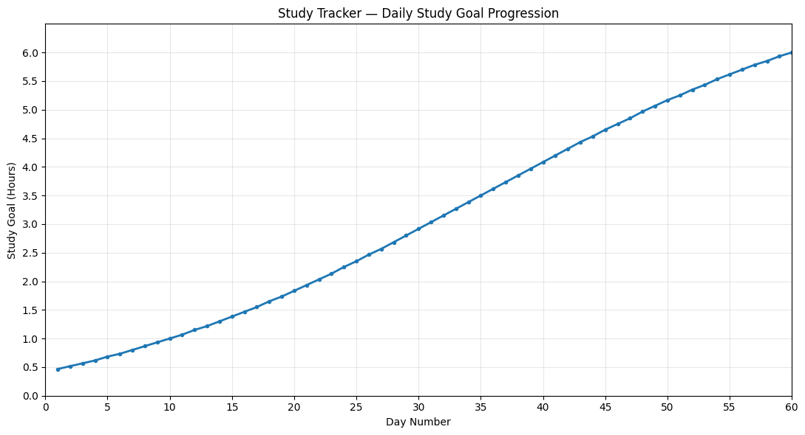

[](LICENSE) 

# Study Tracker (stdt)

A lightweight, installable terminal study tracker to track your study sesions. Stores progress in a per-user JSON file.

## Table of Contents

- [Features](#features)
- [Usage](#usage)
- [Requirements](#requirements)
- [Installation](#installation)
- [Import Library](#import-library)
- [Tech Stack](#tech-stack)
- [License](#license)

## Features



- Study Tracker aims to help you build a habit to study every day for 6 hours consistently in 2 months.
- Study time starts from 30~ minutes and uses a logistic growth rate of 0.06 up to 6 hours.
- You will be given two daily tasks of the following:
1. Listen to a lecture for x hours/minutes. The duration is flexible, so find a lecture similar to the duration and watch through all of it. Always consider taking breaks.
2. Solve x questions preferably about the lecture you've listened to.

- You have the ability to go back one day if you've failed to do any meaningful studies for that day.
- You can reset the progression if you feel like you've been burning out.

## Usage

- You can use Study Tracker by running these commands from your terminal after installation.

```text
stdt               Open the interactive main menu
stdt -b / --back   Go back one progression day
stdt -r / --reset  Reset progression to day 1
stdt --version     Print installed version
stdt --help        Show command help
stdt-predict       Open the original study-goal forecaster
```

## Requirements

- Python 3.10 or newer
- Optional colors: `py -m pip install "stdt[color]"`

## Installation

Extract the project, open a terminal in its folder, and run:

```powershell
py -m pip install --user .
```

This installs the `stdt` command into your user Python Scripts directory. To make it callable from any terminal location, ensure that directory is on your Windows PATH. You can find your user base with `py -m site --user-base`; the Scripts directory is the `Scripts` folder inside that location. Add that full path to your user PATH once, then reopen your terminal.

For development, use `py -m pip install --user -e .` instead.

## Import Library

```python
import stdt

print(stdt.get_daily_target(10))
print(stdt.get_study_goals(10))
print(stdt.get_data_file())
print(stdt.load_start_date())
```

## Tech Stack

- **Python**

## License

This project is licensed under the MIT License — see the [LICENSE](LICENSE) file for details.

---

Built by **zgndia**
