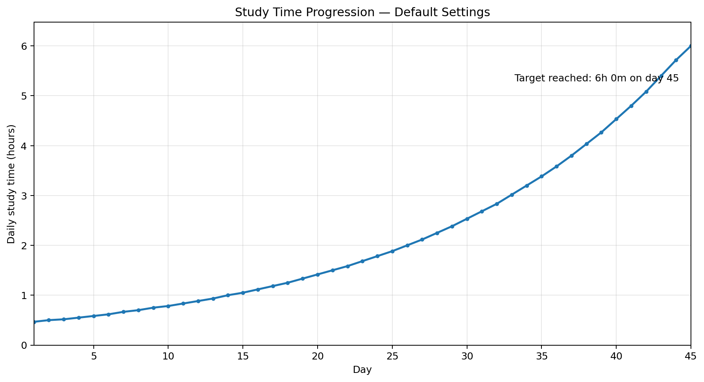

[](LICENSE) 

# Study Tracker (stdt)

A lightweight, installable terminal study tracker. It stores progression and settings in per-user JSON files and uses configurable daily compound growth to build a consistent study habit.

The graph below uses the built-in defaults: 6% daily compound growth and a 6-hour maximum. It plots total daily study time against progression day.



To regenerate it, install the optional graph dependency and run the generator from the repository root:

```powershell
py -m pip install -e ".[graph]"
py scripts/generate_progression_graph.py
```

## Table of Contents

- [Features](#features)
- [Requirements](#requirements)
- [Installation](#installation)
- [Usage](#usage)
- [Import Library](#import-library)
- [Tech Stack](#tech-stack)
- [License](#license)

## Features

- Compounds the daily study target by the configured percentage until the maximum is reached.
- Splits each day's target between lecture time and question solving.
- Lets you customize the study increase rate and maximum daily target.
- Previews the plan through the first day the maximum target is reached, without changing saved settings.
- Includes a Matplotlib graph of the default study-time progression.
- Keeps progression and settings in your user application-data directory.
- No required third-party dependencies.

## Requirements

- Python 3.10 or newer
- Optional colors: `py -m pip install "stdt[color]"`

## Installation

Extract the project, open a terminal in its folder, and run:

```powershell
py -m pip install --user .
```

This installs the `stdt` command into your user Python Scripts directory. To make it callable from any terminal location, ensure that directory is on your Windows PATH. You can find your user base with `py -m site --user-base`; the Scripts directory is the `Scripts` folder inside that location. Add that full path to your user PATH once, then reopen your terminal.

For development, use `py -m pip install --user -e .` instead.

## Usage

| Command | Description |
| --- | --- |
| `stdt` | Open the interactive main menu |
| `stdt -b` / `stdt --back` | Go back one progression day |
| `stdt -r` / `stdt --reset` | Reset progression to day 1 |
| `stdt -e rate="10%"` | Set the study increase rate to 10% |
| `stdt -e target="6h"` | Set the maximum daily target to 6 hours |
| `stdt -e rate="10%", target="6h"` | Update multiple settings at once |
| `stdt --preview` | Print the plan until the configured target is first reached |
| `stdt --preview target="6h", rate="5%"` | Preview a plan with temporary overrides; does not save them |
| `stdt --version` | Print the installed version |
| `stdt --help` | Show command help |
| `stdt-predict` | Open the interactive study-goal forecaster |

The example 6-hour ceiling is split into 4 hours of lectures and 2 hours of question solving. The question estimate uses a planning pace of 50 questions per hour (about 1.2 minutes per question), so the final day targets 100 questions. Actual solving time will vary by subject and difficulty.

Both `--back` and `--reset` ask for confirmation with `[Y/n]`. Press Enter or type `y` to confirm; type `n` to cancel. The interactive menu also supports `b`, `r`, and `q`.

## Import Library

```python
import stdt

print(stdt.get_daily_target(10))
print(stdt.get_study_goals(10))
print(stdt.get_data_file())
print(stdt.get_settings_file())
print(stdt.load_start_date())
print(stdt.load_settings())
```

## Tech Stack
- Python

## License

This project is licensed under the MIT License — see the `LICENSE` file for details.

Built by **zgndia**.
